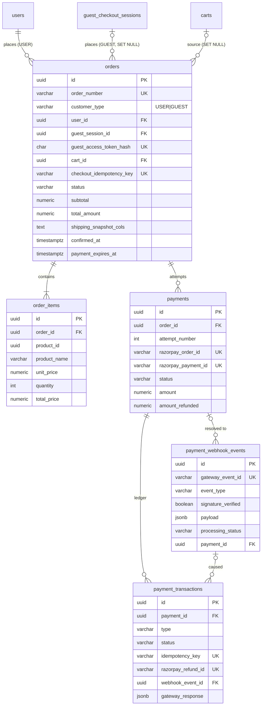

# Payment Database Design (Phase 1)

Migrations: `005_create_orders.sql`, `006_create_payments.sql`, `007_create_payment_webhook_events.sql`
(rollbacks in `migrations-down/`). Run with `npm run migrate`.

## ER diagram

## Status definitions

**orders.status**

| Status | Meaning | Payable? |
|---|---|---|
| `PENDING_PAYMENT` | Created, no successful payment yet | yes |
| `PAYMENT_FAILED` | Latest attempt failed; order kept | yes (retry) |
| `PAID` | A payment was captured; order confirmed | no |
| `CANCELLED` | Cancelled by customer/admin | no |
| `EXPIRED` | `payment_expires_at` passed unpaid | no |
| `PARTIALLY_REFUNDED` / `REFUNDED` | After capture, refunds issued | no |

Transitions: `PENDING_PAYMENT → PAID | PAYMENT_FAILED | CANCELLED | EXPIRED`;
`PAYMENT_FAILED → PAID | CANCELLED | EXPIRED`; `PAID → PARTIALLY_REFUNDED → REFUNDED`.
Fulfilment (shipped/delivered) is deliberately out of scope and can be a separate column later.

**payments.status** (one attempt): `CREATED` (Razorpay order made) → `PENDING` (checkout opened / payment in progress)
→ `AUTHORIZED` → `CAPTURED` → `PARTIALLY_REFUNDED` → `REFUNDED`; terminal failures: `FAILED`, `CANCELLED`, `EXPIRED`.

**payment_transactions**: `type` ATTEMPT / AUTHORIZATION / CAPTURE / FAILURE / REFUND; `status` PENDING / SUCCESS / FAILED.

**payment_webhook_events.processing_status**: `RECEIVED → PROCESSING → PROCESSED | IGNORED | FAILED` (FAILED is retryable).

## Key design decisions

1. **Order first, payment second.** `payments.order_id` is `NOT NULL` + FK, so a payment cannot exist without an internal order. The order is created from the cart in one DB transaction (order + items), and the cart is only marked `COMPLETED` after payment succeeds.
2. **Order and payment are separate state machines.** A failed payment sets `payments.status=FAILED` and `orders.status=PAYMENT_FAILED`; nothing is deleted. All FKs into `orders`/`payments` are `ON DELETE RESTRICT`, so history can't be lost by accident.
3. **Retries = new `payments` row** (`attempt_number` 1, 2, 3 … unique per order), each with its own Razorpay order id. Clean per-attempt history and no mutation of a failed attempt. Retry eligibility is `orders.status IN (PENDING_PAYMENT, PAYMENT_FAILED)` and `payment_expires_at > now()`.
4. **Duplicate-payment prevention, enforced in the database, not just code:**
   - `uq_payments_one_success_per_order` – a second capture for the same order violates a partial unique index.
   - `uq_payments_one_open_per_order` – only one in-flight attempt; double-clicks can't open two checkouts.
   - `uq_payments_razorpay_order` / `uq_payments_razorpay_payment` – gateway ids map to one row.
   - `payment_transactions.idempotency_key` (e.g. `capture:pay_X`) – client verify call and webhook for the same fact collapse to one ledger row.
   - `payment_webhook_events (gateway, gateway_event_id)` – Razorpay redelivery is a no-op insert (`ON CONFLICT DO NOTHING`).
   - **Single confirmation:** confirm with `UPDATE orders SET status='PAID', confirmed_at=now(), paid_at=now() WHERE id=$1 AND confirmed_at IS NULL`; only the caller that affects 1 row sends the confirmation email / clears the cart. `orders_paid_chk` guarantees `PAID` implies `confirmed_at`.
5. **Payment history is append-only.** `payment_transactions` has a trigger rejecting UPDATE/DELETE; refunds are rows with a unique `razorpay_refund_id`. `payments.amount_refunded` is the running total (≤ `amount`, checked).
6. **Webhook inbox pattern.** Persist the raw event first (payload JSONB, `signature_verified`), then process; failed events stay queryable (`idx_webhook_events_pending`) for retry. The signature header and webhook secret are **not** stored.
7. **Historical snapshots.** `order_items` copy product name/slug/unit price/qty (no FK to `cart_items` or products; `product_id` is a plain reference to the external product service). Orders copy customer email/phone and the full shipping address instead of referencing `user_addresses` or `guest_checkout_sessions`. `orders_total_chk` and `order_items_total_chk` keep arithmetic consistent.
8. **Authenticated vs guest ownership.** `customer_type` + `orders_owner_chk`: `USER` requires `user_id`; `GUEST` requires `guest_access_token_hash` (hash only, same pattern as `guest_checkout_sessions`) and has no `user_id`. `guest_session_id` is `ON DELETE SET NULL` because the existing cleanup job purges sessions (and cart deletion cascades to them); the order survives and the guest still reaches it via the token. `cart_id` is likewise a weak reference.
9. **Idempotent order creation.** Optional `checkout_idempotency_key` (unique) lets a retried "create order" request return the same order.
10. **No gateway secrets in the DB.** No key id/secret/webhook-secret columns anywhere; `gateway_response` stores sanitized Razorpay response bodies only. Secrets stay in environment config.
11. **Money** uses `NUMERIC(12,2)` in rupees, consistent with `carts`. Convert to paise (integer) at the Razorpay API boundary in Phase 2.

## Notes / caveats

- Cross-table invariants a CHECK can't express (sum of `order_items.total_price` = `orders.subtotal`; `payments.amount` = `orders.total_amount`) must be asserted in the service layer inside the creating transaction.
- The migrations were **not executed**: no local PostgreSQL is installed and I did not run them against the Supabase URL in `.env.example`. Please run `npm run migrate` against a dev database to validate.
- `.env.example` contains what looks like a real Supabase connection string with password. Rotate it and replace with a placeholder.
